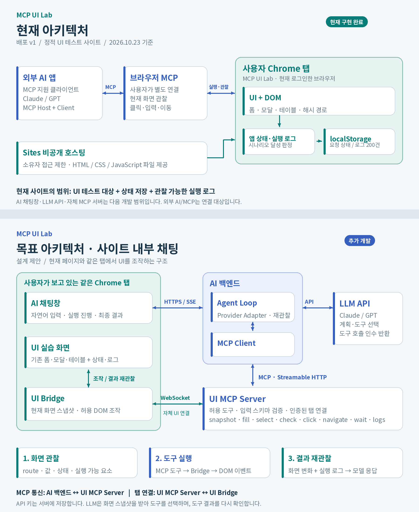

# MCP UI Lab 아키텍처·개발 스펙

작성일: 2026-10-23 (Asia/Seoul) · 기준: 배포 v1 · 문서 버전: 1.0

현재 사이트: https://mcp-ui-lab.wintryhorse5.chatgpt.site

## 1. 목적과 현재 상태

이 프로젝트는 자연어 명령으로 웹 UI를 조작하고, 실제 화면 상태와 실행 로그로 결과를 확인하는 테스트 환경이다. 현재 배포본은 외부 AI와 브라우저 MCP가 조작할 수 있는 정적 UI 실습 사이트다. 원래 목표인 **사이트 내부 AI 채팅창에서 같은 사이트의 UI를 MCP로 조작하는 방식(A)** 은 다음 개발 범위다.

**현재 구현:** 폼·모달·테이블·페이지 이동·모의 지연 응답, 6개 시나리오, 자동화 식별자, 실행 로그와 브라우저 내 상태 저장.

**추가 개발:** 내부 채팅창, LLM Provider Adapter, Agent Loop, MCP Client/Server, 현재 탭 UI Bridge, 인증된 탭 연결과 통합 테스트.

현재 접속 정책은 소유자 1명만 허용하며 외부 방문자는 0명이다. 공개 전환은 소유자의 명시적 확인이 필요하다.

## 2. 아키텍처 이미지



### 현재 구조

MCP 연결을 지원하는 외부 Claude/GPT 클라이언트가 브라우저 MCP를 통해 로그인된 브라우저 탭을 관찰하고 조작한다. Sites는 비공개 정적 파일을 제공하고, 브라우저의 JavaScript가 DOM·상태·로그를 갱신한다. 사이트 자체는 LLM이나 MCP 서버를 호출하지 않는다. MCP 클라이언트 종류에 따라 현재 Chrome 세션을 연결하는 방법과 인증은 별도 설정이 필요하다.

### 목표 구조: 사이트 내부 채팅

1. 사용자가 사이트 내부 채팅창에 명령을 입력한다.
2. AI 백엔드가 인증된 사용자·탭을 묶고 현재 화면 스냅샷을 가져온다.
3. Provider Adapter가 스냅샷·도구 정의·대화 내용을 LLM API에 전달한다.
4. LLM이 도구를 선택하면 Agent Loop가 MCP Client로 UI MCP Server를 호출한다.
5. UI MCP Server가 현재 탭의 UI Bridge에 명령을 전달한다.
6. Bridge가 허용된 DOM 조작을 수행하고, 실제 화면 변화·로그를 관찰해 결과를 반환한다.
7. Agent Loop가 관찰 결과를 LLM에 다시 전달한다. 필요한 도구를 더 실행하고 최종 결과를 채팅으로 보여 준다.

**MCP 경계:** AI 백엔드 ↔ UI MCP Server. **WebSocket 경계:** UI MCP Server ↔ 브라우저 UI Bridge. 후자는 현재 탭으로 명령을 전달하는 자체 애플리케이션 통신이다. LLM은 MCP 연결을 직접 소유하지 않으며, AI 앱의 Agent Loop와 MCP Client가 도구 호출을 수행한다.

## 3. 현재 기술 스펙

| 구분 | 현재 배포 v1 |
| --- | --- |
| 프론트엔드 | HTML5 + CSS + Vanilla JavaScript (strict mode, IIFE) |
| 프레임워크·빌드 | Vue/React 미사용 · package.json 및 빌드 의존성 없음 |
| 라우팅 | location.hash + hashchange · 브라우저 뒤로 가기 지원 |
| 저장소 | localStorage, 키: mcp-ui-lab-v1 · 서버 DB 없음 |
| 호스팅·접근 | Sites 정적 dist/ 제공 · 소유자 1인 허용 · 외부 방문자 0명 |
| 로그·응답 | 브라우저 이벤트 로그 최대 200건 · JSON 다운로드 · 1.5초 모의 응답 |
| AI/MCP | 브라우저 자동화 대상 UI 제공 · 내부 채팅/LLM API/자체 MCP 서버 미구현 |

### 소스 구성

- `dist/index.html`: 화면 구조, 라벨, 식별자, native dialog.
- `dist/style.css`: 반응형 화면, 테이블 스크롤, 모바일 하단 메뉴.
- `dist/app.js`: UI 이벤트, 렌더링, 라우팅, 로그, 저장, 시나리오 달성 로직.
- `.openai/hosting.json`: Sites 정적 배포 설정(`dist/`).
- `README.md`: 기능·실행·범위·접근 정책.
- `QA.md`: 2026-10-22 브라우저 검증 기록.

현재 코드는 전역 외부 의존성 없이 브라우저 API로 실행한다. 별도 npm 설치나 빌드 명령이 없다. 현재 구현에는 Vue, Node 서버, 외부 DB가 포함되지 않는다.

## 4. 기능 명세와 화면 경로

| 영역 | 현재 동작 | 주요 식별자 |
| --- | --- | --- |
| 입력 폼 | 이름 필수·최대 60자, 메모 최대 300자, 유형·우선순위·저장 동의 | request-name / request-category / request-priority / request-note / request-consent |
| 제출·검증 | 이름 공백 또는 동의 미체크 시 차단, 오류·성공 표시, 목록 추가 | submit-request / form-result / name-error / consent-error |
| 모달 | native <dialog>, 열기·취소·확인·Escape, 닫힌 후 포커스 복원 | open-modal / confirm-dialog / modal-cancel / modal-confirm |
| 테이블 | 이름·ID 검색, 상태 필터, 이름 정렬, 행·현재 페이지 선택, 완료 처리, 4건씩 페이지 | table-search / table-status / sort-name / complete-selected / prev-page / next-page |
| 페이지 이동 | 실습·시나리오·목록·상세·가이드, hash 경로와 브라우저 기록 | back-to-list / detail-REQ-1042 / record-id / record-title |
| 지연 응답 | 1500ms 타이머, loading 중 비활성, success 또는 error 표시 | response-mode / async-start / async-result[data-state] |
| 관찰·보조 | 로그 필터·삭제·JSON 내보내기, 달성 상태, 명령 복사, 초기화 확인 | event-log / completed-count / export-logs / reset-session |

`id` 또는 `data-testid`를 자동화 계약으로 사용한다. 동적 행은 `row-REQ-1042`, 체크박스는 `select-REQ-1042`, 상세 링크는 `detail-REQ-1042` 형태다. 접근 가능한 라벨/role로도 요소를 찾을 수 있다.

| 경로 | 화면 |
| --- | --- |
| `#lab` 또는 빈 hash | UI 실습 |
| `#scenarios` | 6개 자연어 테스트 명령·예상 결과·명령 복사 |
| `#pages` | 요청 탐색 목록(현재 최대 앞 6개) |
| `#record/REQ-1042` | 요청 상세(목록 데이터와 같은 상태 사용) |
| `#guide` | 브라우저 MCP 연결 안내·시작 명령·식별자 안내 |

잘못된 일반 경로는 실습 화면으로 처리한다. 존재하지 않는 상세 ID에는 찾을 수 없음 화면과 `navigation.not_found` 오류 로그를 표시한다.

### 선택값과 기본 데이터

- 유형: `ui`(UI 테스트), `api`(API 테스트), `integration`(통합 테스트).
- 우선순위: `normal`(보통), `high`(높음), `low`(낮음).
- 상태: `pending`(대기), `running`(진행 중), `done`(완료).
- 초기 요청: 8개(`REQ-1035`~`REQ-1042`), 다음 생성 ID는 `REQ-1043`.
- 테이블 페이지당 4건. 검색은 이름·ID의 부분 일치이며 상태 필터와 함께 적용한다.
- 지연 응답은 `setTimeout(1500)`으로 만든 **모의 응답**이다. 화면의 200/500 문구는 실제 HTTP 요청의 상태 코드가 아니다.
- 폼 이름/메모는 trim 후 저장한다. 저장 동의는 필수다. 길이 제한은 HTML maxlength 속성으로 제공한다.

## 5. 데이터·로그 명세

### 현재 영속 상태 예시

아래 JSON은 구조 설명용 예시이며 실사용 데이터 덤프가 아니다.

```json
{
  "rows": [
    {
      "id": "REQ-1042",
      "name": "로그인 폼 자동화",
      "category": "ui",
      "priority": "high",
      "status": "pending",
      "note": "..."
    }
  ],
  "logs": [
    {
      "id": "evt-example",
      "timestamp": "2026-10-22T14:00:00.000Z",
      "type": "info",
      "event": "session.ready",
      "message": "UI Lab이 준비되었습니다.",
      "detail": "browser-local · 6 scenarios"
    }
  ],
  "completed": [],
  "nextId": 1043,
  "form": {
    "name": "",
    "category": "ui",
    "priority": "normal",
    "note": "",
    "consent": false
  }
}
```

`rows`, `logs`, `completed`, `nextId`, `form`을 localStorage의 `mcp-ui-lab-v1`에 저장한다. 로그는 최신순 최대 200건이고 timestamp는 ISO 형식이다. 로그 유형은 `info`, `success`, `error`다.

테이블 검색·필터·정렬·현재 페이지·선택 항목과 시나리오 중간 증거 플래그는 메모리에 있다. 새로고침 후 요청·폼·로그·최종 달성 상태는 복구되지만, 중간 테스트 단계는 다시 시작해야 할 수 있다. 브라우저·프로필·기기 간에는 동기화하지 않는다. 저장소 사용 실패 시 현재 탭 메모리로 동작하고 안내를 표시한다.

### 주요 이벤트

| 영역 | 이벤트 |
| --- | --- |
| 세션 | `session.ready`, `session.reset` |
| 폼 | `form.change`, `form.validation`, `form.submit` |
| 모달 | `modal.open`, `modal.cancel`, `modal.confirm` |
| 테이블 | `table.search`, `table.filter`, `table.sort`, `table.select`, `table.select_all`, `table.bulk_complete`, `table.page` |
| 페이지 | `navigation.change`, `navigation.not_found` |
| 비동기 | `async.start`, `async.success`, `async.error` |
| 시나리오 | `scenario.complete` |

JSON 내보내기 최상위 키는 `application`, `exportedAt`, `completedScenarios`, `events`다. 로그 삭제는 달성 상태를 유지한다. 세션 초기화 확인 시 요청·폼·달성 상태를 기본값으로 복원하고 로그도 초기화한 뒤 `session.reset` 이벤트를 기록한다.

## 6. 테스트 시나리오와 검증 범위

| ID | 명령 핵심 | 확인할 결과 |
| --- | --- | --- |
| form | 정해진 이름·유형·우선순위·메모 입력 후 동의·제출 | MCP 자동화 테스트 / integration / high / 브라우저 MCP 실습, 신규 요청 |
| validation | 이름 비우기 + 동의 해제 후 제출 | 두 오류 메시지 표시, 요청 개수 유지 |
| modal | 열기 → 취소 → 재열기 → 확인 | 대화상자 닫힘, modal.cancel / modal.confirm |
| table | 로그인 검색 → 이름 정렬 → 선택 완료 → 다음 페이지 | REQ-1042가 완료, 다음 페이지 표시 |
| navigation | REQ-1042 상세 열기 → 목록 복귀 | #record/REQ-1042 제목·ID 일치 후 #pages |
| async | 성공 요청 후 실패 요청 | loading → success, loading → error / 버튼 비활성 해제 |

### 현재 확인한 근거

- 배포 v1의 소스 commit: `90f78fd1367408acfb8a7ba9c9b275e01bc0a358`.
- 배포 메타데이터와 로컬 소스 HEAD가 일치하는 것을 확인했다.
- 기존 `QA.md`에는 2026-10-22 지원 브라우저 조작(CUA)으로 6개 시나리오를 수행하고 6/6 달성을 확인한 기록이 있다.
- 당시 추가 점검: 입력 검증·취소/초기화·명령 복사·JSON 파싱·상태 유지·390px 반응형·로그 필터·검색 결과 없음.
- 이번 문서 작업은 소스와 배포 메타데이터를 검토했다. 브라우저 시나리오를 재실행하거나 외부 Claude/GPT MCP 연결을 새로 검증하지 않았다.

**앱의 시나리오 달성 표시는 테스트 증거의 일부다.** 예를 들어 페이지 왕복 달성은 상세 진입 후 목록으로 돌아오는 동작을 관찰한다. 특정 ID·제목·변경값이 맞는지와 실제 도구가 성공했는지는 별도 E2E 단언으로 함께 확인해야 한다. 외부 모델·MCP 연결 통합 검증은 아직 남아 있다.

## 7. 내부 채팅 확장 개발 스펙(제안)

| 구성 | 개발 제안 | 역할 |
| --- | --- | --- |
| 프론트엔드 | 1차는 현재 정적 UI 유지, 확장 시 Vue 3 + TypeScript + Vite | 사용자의 Vue 경험을 반영한 전환 후보 |
| AI 백엔드 | Node.js + TypeScript | Provider Adapter, Agent Loop, 인증·진행 이벤트 |
| MCP | 공식 TypeScript SDK, 호환 버전 고정 | 도구 목록/호출, 입력 스키마와 결과 검증 |
| 연결 | HTTPS + SSE / MCP Streamable HTTP / WebSocket | 채팅 진행 / MCP / 현재 브라우저 탭 연결을 구분 |
| 상태·검증 | 초기 localStorage 유지, Playwright E2E 추가 | 기존 6개 시나리오를 회귀 기준으로 유지 |

기술 선택은 구현 제안이다. 현재 설치되었다는 의미가 아니다. 실제 착수 시 SDK·런타임·LLM 제공자 호환성을 확인해 `package.json`과 lockfile에 버전을 고정한다. 첫 연결은 정적 UI를 유지해 동작을 검증하고, Vue 전환은 별도 변경으로 진행한다.

Claude Code는 개발 도구다. 사이트에서 명령을 해석하는 런타임은 서버의 LLM Provider Adapter를 통해 호출하는 API다. 첫 제공자 1개로 end-to-end를 완성하고 같은 인터페이스에 두 번째 제공자를 추가한다.

### 화면 정보를 LLM에 전달하는 방식

앱 전용 요소 등록부를 만들고 현재 경로·표시된 UI·값·선택지·활성 여부·오류·결과·최근 로그를 구조화해 보낸다. 전체 HTML이나 스크린샷을 매번 전송하지 않는다. 브라우저 Bridge의 스냅샷은 앱에서 정의한 JSON이며, Playwright가 수집하는 접근성 트리와는 구별한다.

```json
{
  "snapshotId": "snap-0007",
  "revision": 7,
  "route": "#lab",
  "elements": [
    {
      "targetId": "request-name",
      "role": "textbox",
      "label": "요청 이름",
      "value": "",
      "enabled": true,
      "visible": true,
      "maxLength": 60
    },
    {
      "targetId": "request-category",
      "role": "combobox",
      "value": "ui",
      "options": [
        "ui",
        "api",
        "integration"
      ]
    }
  ],
  "recentEvents": [
    "session.ready"
  ]
}
```

초기 UI가 아닌 현재 화면을 관찰한 후 도구를 선택한다. 쓰기 작업에는 `expectedRevision`을 넣어 이전 화면에 기반한 명령을 거절하고 다시 관찰한다. 모달·로딩·라우트 전환도 revision과 요소 상태에 반영한다. 채팅 입력창과 API 키 등 비밀값은 자동화 등록부·스냅샷에서 제외한다.

### MCP 도구 계약(미구현 제안)

| 도구 제안 | 주요 입력 | 결과·제약 |
| --- | --- | --- |
| ui.get_snapshot | 관찰 범위(선택) | route, revision, 요소·값·상태. 채팅/비밀값 제외 |
| ui.fill | targetId, value, expectedRevision | 허용 input/textarea만, input/change 이벤트 |
| ui.select | targetId, value, expectedRevision | 등록된 select와 허용 option만 |
| ui.check | targetId, checked, expectedRevision | checkbox만, 이미 같은 값이면 유지 |
| ui.click | targetId, expectedRevision | 표시·활성 상태 확인 후 허용 버튼 클릭 |
| ui.navigate | route, expectedRevision | 허용된 내부 hash 경로만 |
| ui.wait_for | targetId, condition, timeoutMs | 상태/표시/비활성 조건을 관찰, 무한 대기 금지 |
| ui.get_logs | since, limit | 관련 실행 로그만 반환, 기존 최대 200건 정책 |

공통 인증 컨텍스트의 `userId/sessionId/tabId`는 서버가 연결에서 결정한다. LLM이 임의 사용자나 탭을 선택하게 하지 않는다. `commandId`로 실행과 응답을 연관시키고, 중복 실행을 막기 위한 짧은 결과 캐시를 둔다. 응답이 유실된 제출 명령은 자동 재실행 전에 화면과 로그에서 실제 등록 여부를 먼저 확인한다.

도구 호출 전달 예시:

```json
{
  "commandId": "cmd-0008",
  "requestId": "req-chat-001",
  "tool": "ui.fill",
  "arguments": {
    "targetId": "request-name",
    "value": "MCP 자동화 테스트",
    "expectedRevision": 7
  }
}
```

Bridge 관찰 결과 예시:

```json
{
  "commandId": "cmd-0008",
  "status": "succeeded",
  "observed": {
    "targetId": "request-name",
    "value": "MCP 자동화 테스트"
  },
  "revision": 8,
  "eventIds": [
    "evt-example"
  ]
}
```

서버는 도구 입력 스키마와 targetId 허용 목록을 검증한다. Bridge는 현재 문서에서 허용 요소를 다시 찾고 표시·활성·revision을 확인한 뒤 input/change/click 등 연결된 UI 이벤트를 발생시킨다. 도구 완료는 이벤트 전달만으로 판정하지 않고 바뀐 DOM 상태와 관련 로그를 관찰해 확인한다. `wait_for`는 조건 기반 제한 대기이며, AI 실행에는 최대 단계·시간·중지 기능을 둔다.

임의 JavaScript 실행과 임의 외부 URL 이동은 도구에 포함하지 않는다. API 키는 서버 환경변수로 보관한다. 탭 연결은 사용자 인증과 origin 검사를 거치며 HTTPS/WSS를 사용한다. 연결 종료 후에는 대기 중 명령을 실패 처리하고 재연결 시 최신 스냅샷을 다시 받는다.

### Playwright의 위치

앱 내부 Bridge는 자기 사이트 DOM을 조작하는 범위다. 브라우저 주소창·다른 사이트·다른 탭·신뢰된 사용자 제스처가 필요한 기능은 범위 밖이다. Bridge의 합성 이벤트는 실제 사용자 입력이나 Playwright의 브라우저 입력과 같다고 간주하지 않는다. Playwright는 별도 E2E 테스트 계층으로 사용해 화면 상태·접근성 라벨·식별자 계약·실제 클릭/입력 경로를 검증한다.

### 배포 구성

현재 Sites 배포는 정적 파일 제공 구성이다. Node 백엔드를 추가하려면 그 런타임과 장기 연결을 지원하는 별도 호스트가 필요하다. Sites에 서버까지 통합하려면 Worker에 맞춘 서버 코드와 WebSocket 세션 구성을 별도 설계한다. 현재 정적 사이트에 Node 서버 파일을 넣는 것만으로 서버가 실행되지는 않는다. 두 경우 모두 기존 비공개 접근 정책과 사용자-탭 연결을 유지하도록 구현해야 한다.

## 8. 개발 순서와 완료 기준

| 단계 | 작업 | 완료 기준 |
| --- | --- | --- |
| 0. 기준 유지 | 현재 v1 소스와 6개 시나리오를 기준점으로 고정 | 기존 UI·식별자·로그 동작 확인 |
| 1. 현재 탭 Bridge | 요소 등록부·스냅샷·허용 DOM 조작·탭 연결 | LLM 없이 연결 도구로 폼 1개 등록, 화면·로그 일치 |
| 2. MCP 도구 | MCP 서버·클라이언트·스키마·실행 결과 | MCP 도구 탐색·호출로 같은 탭의 6개 흐름 실행 |
| 3. 내부 AI 채팅 | Agent Loop·Provider Adapter·중지·진행 표시 | 내부 명령 → 도구 실행 → 실제 화면 확인 → 결과 답변 |
| 4. 통합 검증·배포 | 외부 모델 통합·Playwright 회귀·세션 격리 | 두 탭 격리, 연결 끊김, 실패·재시도 확인 후 비공개 배포 |

### 최소 완료 기준

1. 내부 채팅에서 “요청 이름을 입력하고 등록해 줘”를 보내면 사용자가 보는 같은 탭에 실제 값과 신규 행이 나타난다.
2. 모델의 성공 응답은 실제 화면·로그를 확인한 도구 결과와 일치한다.
3. 6개 시나리오를 MCP 통합 테스트로 수행하고 예상 값·ID·오류·페이지·대기 상태를 단언한다.
4. 탭 두 개를 열어도 다른 탭에 명령이 실행되지 않는다. 새로고침·연결 종료·중지에 명확히 대응한다.
5. 실패·시간 초과·중복 호출로 요청이 이중 등록되지 않으며 성공으로 잘못 보고하지 않는다.
6. 공개 전환 없이 소유자만 접근하는 상태로 동작한다.

### Claude Code에 전달할 첫 구현 지시문

> 현재 dist/index.html, dist/style.css, dist/app.js와 README.md, QA.md를 읽고 기존 6개 시나리오, id/data-testid, 로그 계약을 보존해 줘. 첫 단계에서는 LLM이나 Vue 전환을 추가하지 말고 현재 탭 UI Bridge부터 구현해 줘. 허용 요소 등록부와 get_snapshot/fill/select/check/click/navigate/wait_for/get_logs를 만들고, 기존 UI 이벤트 경로를 사용해 조작한 다음 실제 DOM과 로그로 결과를 확인해 줘. 앱 상태를 직접 바꿔 UI 테스트를 우회하지 말아 줘. 채팅 입력창은 자동화 대상에서 제외하고, commandId 중복 방지·revision 검증·사용자-탭 바인딩·연결 종료 처리를 설계해 줘. 로컬 동작과 기존 시나리오 회귀를 확인한 뒤 공식 MCP TypeScript SDK와 연결하는 다음 단계를 제시해 줘. 비공개 설정은 유지해 줘.

## 9. 근거와 참고 문서

- 현재 프로젝트 소스: `dist/index.html`, `dist/app.js`, `dist/style.css`, `README.md`, `QA.md`, `.openai/hosting.json`(위 commit 기준).
- Sites 메타데이터: 배포 v1, 현재 URL, 소유자 전용 접근 정책(2026-10-23 확인).
- 공식 MCP TypeScript SDK: https://ts.sdk.modelcontextprotocol.io/
- MCP Client와 전송 방식: https://ts.sdk.modelcontextprotocol.io/v2/clients/connect.html
- MCP HTTP 서버: https://ts.sdk.modelcontextprotocol.io/v2/serving/http.html
- Playwright 요소 식별: https://playwright.dev/docs/locators

참고 문서는 MCP Client/Server 역할과 전송 방식, Playwright role/label/test-id 식별의 근거다. 이 문서의 Bridge 프로토콜·도구 이름·개발 단계는 프로젝트를 위한 설계 제안이다.
